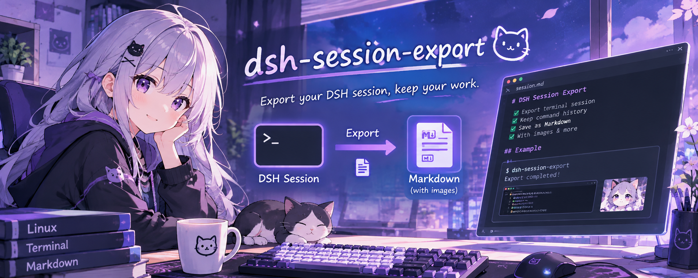

<p align="center"></p>

# dsh-session-export

给 DeepSeek Harness（DSH）桌面端 / Web 端的**会话导出**插件。

它只在 **设置** 里增加一个「会话导出」分区，不往侧栏或聊天页塞按钮，避免打断日常界面。
在这里可以：

- 选择**一个会话**或**多个会话**；
- 选择要导出的内容，默认是**用户提问 + 每次对话的最终回答**；
- 按需附加思考过程、工具调用与结果、系统与运行时上下文；
- 导出为 **Markdown** 或 **JSON**，多会话会合并成一个文件。

## 功能

| 能力 | 说明 |
| --- | --- |
| 单会话 / 多会话 | 会话列表支持搜索、全选、清空和逐行勾选 |
| 默认内容 | 用户提问 + 每轮最后一条助手文本回答 |
| 可选内容 | 思考过程、工具调用与结果、系统/运行时上下文 |
| 输出格式 | Markdown（适合阅读、归档、粘贴到笔记）或 JSON（适合程序处理） |
| 标题与元数据 | 导出文件包含会话标题、ID、工作目录、创建/最后活动时间、状态 |
| 只读 | 只读取会话日志，不修改会话、不写工作区记账、不删除任何东西 |
| 隐私 | 所有内容在 Host 本机生成，不联网、不上传 |

### 默认内容与「最终回答」的判定

- **用户提问**只取真正的用户输入（`source.kind === 'user'` / `user-questions`），不会把运行时的
  `runtime-context`、skill 列表、时间上下文当成用户问题。
- **最终回答**取每一轮里最后一条带文本（或图片/文件附件）的 assistant 消息。中间步骤里的
  reasoning 和 tool-call 不会被误当成最终回答。
- 如果一轮还在运行、尚未产生最终文本，Markdown 中会标注「本轮仍在进行，暂无最终回答」，而不是
  编造内容。
- 一轮已经结束但确实没有文本回答时，会标注「本轮没有文本形式的最终回答」。

## 安装

仓库地址：<https://github.com/vi0let-dev/dsh-session-export>

要求 DSH **0.2.1-rc.2** 左右的桌面端或 `dsh web`，Node `^22.19.0 || >=24.0.0`。

### 方式一：从 GitHub 安装（推荐）

#### 在界面里安装

1. 侧栏 → **插件** → **添加插件**；
2. 在输入框里填：

   ```text
   github:vi0let-dev/dsh-session-export
   ```

3. 点 **安装**。安装完成后会提示 **「立即启用」**，点它启用这个组合包；
4. **完全退出并重启 DSH**（bundle 行不会热加载）；
5. 重启后按 `Ctrl+Shift+R` 硬刷新页面。

#### 用命令行安装

```powershell
# 跟随 main 分支
dsh plugin --profile desktop add github:vi0let-dev/dsh-session-export

# 锁定到某个 tag（推荐，避免以后 main 变化）
dsh plugin --profile desktop add github:vi0let-dev/dsh-session-export#v1.0.0
```

GitHub 直装会在 profile 里放一份副本，不依赖本地插件目录；以后更新插件需要重新安装。
安装后确认 profile 的 `package.json` 里 `dsh.profile.bundles` 包含 `dsh-session-export`，
然后完全退出并重启 DSH。

### 方式二：本地目录（开发调试）

1. 侧栏 → **插件** → **添加插件**；
2. 输入插件目录的绝对路径，例如：

   ```text
   D:\src\dsh-session-export
   ```

3. 点 **安装** → **立即启用**；
4. **完全退出并重启 DSH**，再按 `Ctrl+Shift+R` 硬刷新。

命令行等价写法：

```powershell
dsh plugin --profile desktop add "D:\src\dsh-session-export"
```

> 本地目录安装是软链接，修改代码后重新加载插件/重启即可，但不要删除或移动原目录。
> 本插件没有构建步骤、没有第三方依赖，不需要 `pnpm approve-builds`。

## 使用

打开 **设置 → 会话导出**：

1. 在列表里勾选一个或多个会话（默认会选中最近的、已打开的那个会话）；
2. 在「导出内容」里确认勾选项。默认已选：
   - 用户提问
   - 最终回答
3. 选择 **Markdown** 或 **JSON**；
4. 点 **导出**，浏览器会下载文件。

文件名形如：

```text
dsh-session-<会话标题>-20261017-2315.md
dsh-sessions-3-20261017-2315.json
```

### Markdown 结构

```text
# DSH 会话导出
> 导出时间 / 会话数量 / 导出内容

---
## 会话: <标题>
- 会话 ID / 工作目录 / 创建时间 / 最后活动 / 状态

### 第 1 轮 · 时间
#### 用户提问
...
#### 最终回答
...

（勾选思考过程 / 工具调用时，会以折叠块附在对应轮次下）
```

### JSON 结构

```jsonc
{
  "app": "dsh-session-export",
  "version": 1,
  "exportedAt": 1792249526189,
  "options": { "user": true, "assistant": true, "reasoning": false, "tools": false, "system": false },
  "sessions": [
    {
      "id": "session-...",
      "title": "...",
      "cwd": "C:\\...",
      "createdAt": 1792249261242,
      "updatedAt": 1792249526189,
      "turns": [
        {
          "turn": 1,
          "complete": true,
          "users": [{ "text": "...", "attachments": [] }],
          "assistant": { "text": "...", "attachments": [] },
          "reasoning": [],
          "tools": []
        }
      ]
    }
  ]
}
```

## 隐私与安全边界

- **零网络**：Host 侧不联网，没有遥测、更新检查或上报；浏览器侧只 `fetch` 同源的
  `/api/dsh-session-export/*` 路由。
- **只读**：不写会话日志、不改工作区记账、不删除文件。
- **回环限制**：HTTP 路由只接受本机回环连接，并要求回环 `Host` 头与
  `x-dsh-session-export: 1` 标志头。这样跨站页面无法通过简单的 `fetch` 触发导出，
  DNS rebinding 也会被 `Host` 校验挡下。
- **不打包二进制附件**：默认只导出文本与图片/文件附件的引用（附件 id、文件名），
  不复制附件本体。如果你需要“连附件一起打包”的 ZIP，请使用 DSH 自带的
  `@deepseek-ai/dsh-session-log-export`（会话 Header 菜单里的「下载 Session 日志」）。
- **导出上限**：一次最多 200 个会话，生成结果最多约 32 MB；超过会提示减少会话或内容选项。
- **仓库脱敏**：仓库内不含本机用户名/绝对路径、真实会话 ID、邮箱或凭据；README 的示例路径
  使用 `D:\src\...` 占位。插件运行时的会话内容只在本机处理和下载，不会写入仓库。

## 实现

插件分两侧，和 DSH 的其它 UI 插件一样：

- **Host 侧** `index.js`
  - 注册 `/api/dsh-session-export/list` 与 `/api/dsh-session-export/export`；
  - 列表合并 `sessionPersistence.list()`、活动 `ctx.sessions.list()` 与磁盘会话目录，
    标题/时间从 `storages/session_projcache/sessions/<id>.json` 读取，读不到时回退到日志；
  - 读取时优先用活动会话的 `snapshotEvents()`，冷会话用
    `sessionPersistence.open(id, 'read')`，`sessionQuery.readSession(id)` 作为可选兜底；
  - 把事件归一化为 `turns`，再渲染 Markdown/JSON。
- **浏览器侧** `client.js`
  - 手写 ModuleLoader bundle，只依赖外壳提供的 `react`；
  - 向 `settings.section` 注册一个 `order: 37` 的分区；
  - 所有数据走自己的同源路由；不读取其它插件的 DOM，不挂载全局按钮。

## 自测

```powershell
node test/smoke.mjs
```

当前 16 项测试覆盖：

- 包名 / bundle patch / client id / locale / icon 一致性；
- 默认内容只包含用户提问与最终回答；
- 思考、工具、系统上下文按选项出现；
- 未结束轮次的「进行中」判定；
- Markdown / JSON 渲染、多会话合并、文件名清洗；
- 回环 Host 与自定义请求头校验；
- `GET /list`、`POST /export`（活动会话与冷会话两条读路径）；
- `apply` 的 webServer 路由挂载；
- client bundle 的 Settings 分区注册与中英文字典键一致。

## 已知限制

- 依赖 DSH 的内部服务面（`sessionPersistence`、`sessions`、`settings.section` 等）；
  DSH 大版本升级后如果这些面变化，需要跟着调整。
- 活动会话导出的是**已提交**的事件快照；正在流式生成、尚未 settlement 的那段回答不会出现。
- 默认不导出二进制附件，只保留引用；工具输出可能很长，勾选「工具调用与结果」时请留意导出体积。
- 列表标题优先取投影缓存；极少数没有投影缓存的冷会话可能显示为「未命名会话」，
  但导出文件里仍会从日志的 `session/title` 或首条用户提问补出标题。
- 必须通过 `127.0.0.1` / `localhost` / `[::1]` 访问界面；用自定义域名映射到回环地址时，
  插件接口会因为 `Host` 校验返回 403。
- 插件**没有**发布到 npm；请用 GitHub 地址或本地目录安装，不要直接
  `dsh plugin add dsh-session-export`。

## 卸载

界面：侧栏 → **插件** → 已安装 → 找到 `dsh-session-export` → **卸载**。

命令行：

```powershell
dsh plugin --profile desktop remove dsh-session-export
```

卸载后重启 DSH。插件不保留任何持久状态。

## 版本

- 插件版本：`1.0.0`
- 开发/验证环境：DSH `0.2.1-rc.2` 桌面端，Node `24.x`
- 许可证：MIT

## 目录

```text
dsh-session-export/
├─ index.js             # Host 半身：列表、读取、导出、HTTP 路由
├─ client.js            # 浏览器半身：Settings 分区 UI
├─ cordis.patch.yml     # 挂载 Host 行的 bundle patch
├─ package.json
├─ icon.svg
├─ docs/
│  └─ banner.png        # README 顶部横幅
├─ locale/
│  ├─ zh.json           # 插件管理器的中文标题/描述
│  └─ en.json
├─ test/
│  └─ smoke.mjs
├─ README.md
├─ LICENSE
└─ .gitignore
```
